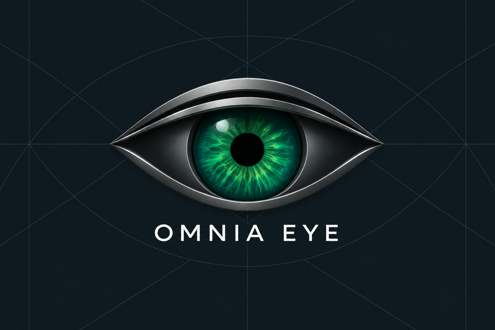
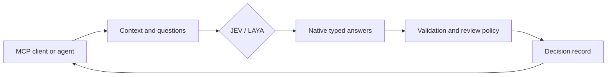

<p align="center"></p>
<h1 align="center">OMNIA MCP</h1>
<p align="center"><strong>JEV/LAYA intelligence for your agents.</strong></p>
<p align="center">Interpret context. Evaluate evidence. Make structured decisions.</p>
<p align="center"><a href="#intelligence-in-context">Capabilities</a> · <a href="#evaluate-several-dimensions">Example</a> · <a href="#quickstart">Quickstart</a> · <a href="docs/configuration.md">Configuration</a> · <a href="docs/validation.md">Validation</a></p>
<p align="center">
  <a href="https://github.com/Omniaeye/omnia-mcp/actions/workflows/ci.yml"></a>
  <a href="pyproject.toml"></a>
  <a href="LICENSE"></a>
</p>

---

**OMNIA MCP brings JEV and local LAYA into agent workflows through the Model Context Protocol.** Give an agent the context, define the questions that matter, and receive decisions it can use: classifications, scored assessments, and probabilities for specific claims.

A single request can assess several dimensions of a document, conversation, software update, or market observation. OMNIA validates the answers, applies your review thresholds, and records the result with its model identity, policy, and evidence references.

## Intelligence in context

The intelligence is in evaluating meaning against context and criteria. The answer format makes that assessment usable by software.

For a news item, an agent can assess the event type, its relevance, who made a claim, and whether the supplied source supports it. For a token observation, it can assess whether fields are complete, whether reported conditions match a policy, and which review category applies. Each question addresses a distinct part of the decision.

| Assessment | Question you can define | Native result |
| --- | --- | --- |
| Event classification | Is this a product launch, a security update, routine maintenance, or something else? | `choice`: selected category and the probability of each alternative |
| Relevance and priority | How significant is the update under our editorial rubric? | `score`: a position across your ordered levels, with its distribution |
| Evidence support | Does the supplied source support, contradict, or leave a claim unaddressed? | `choice`: a bounded assessment of the supplied evidence |
| Attribution | Is the claim made by the main author, a quoted author, or is attribution unclear? | `choice`: explicit alternatives, including an unknown category |
| Completeness | Does this observation contain the fields required by our policy? | `noul`: a probability for the defined true/yes condition |
| Workflow routing | Which review queue or next step best fits this context? | `choice`: an application-defined route |

These are questions you configure through the same evaluation interface. Your application supplies the records and defines the available answers. Exact arithmetic, transaction limits, and mandatory requirements belong in deterministic application checks.

**Several assessments can inform one action.** An application can combine relevance, source support, and attribution before routing an item to an editor. It can combine field completeness, reported risk, and freshness checks before requesting a deeper market review. OMNIA returns the assessments; the application owns their combination and the action that follows.

## JEV/LAYA, natively

OMNIA uses the providers' native decision types. It preserves selected labels, ordinal score semantics, probabilities, and available confidence fields in a common MCP response.

| | JEV | LAYA |
| --- | --- | --- |
| Inference | TypeSafe's hosted evaluation API | Local inference through the public `laya==0.3.20` runtime |
| Model identity | Explicit version; default `jev-1.13.0` | Explicit checkpoint family and full revision SHA |
| Input | Supplied text, JSON objects, or JSON arrays | The same request contract, within the selected checkpoint's input budget |
| Answers | `choice`, `score`, `noul` | `choice`, `score`, `noul` |
| Operation | API credential, bounded HTTP requests, retry controls | Optional runtime, isolated worker, configured device and threads |
| Data path | Context and questions go to TypeSafe | Inference stays local; offline operation uses prepared dependencies and weights |

**Choice** compares the alternatives you define. **Score** evaluates an ordered rubric and can return a value between levels. **Noul** expresses the probability of a specified condition, retaining uncertainty instead of reducing the result to a bare boolean.

Questions in one request share the supplied state and are evaluated independently. For a dependent sequence, the calling agent can pass an earlier result into the next request. Provider selection is explicit; OMNIA does not silently move local context to a hosted service.

## The decision path



The record includes a decision ID, input fingerprint, provider/model identity, answers, applied policy, review reasons, evidence references, timing, and available usage metadata. Repeated identical requests can reuse the configured cache. Earlier decisions can be retrieved by ID.

`accepted` means the response passed the configured checks. `needs_review` preserves answers that fall below a probability or margin threshold. Neither status grants permission to publish, trade, or execute an external action.

## Evaluate several dimensions

This example asks three independent questions about one software update. It keeps the maintainer's statement separate from the quoted comment.

Call `omnia_capabilities` first, then send these arguments to `omnia_evaluate`:

```json
{
  "request": {
    "state": {
      "source": "GitHub",
      "project": "Atlas SDK",
      "main_author": "maintainer",
      "main_update": "Version 2.4 is available. It adds streaming responses and fixes connection recovery.",
      "quoted_comment": {
        "author": "community_member",
        "text": "This will double every customer's revenue."
      }
    },
    "questions": {
      "event_type": {
        "type": "choice",
        "instructions": "Classify main_update. Keep quoted_comment separate from the maintainer's statement.",
        "criteria": {
          "release": "An available software version with described changes",
          "maintenance": "Routine repository upkeep without a release announcement",
          "other": "Neither category is supported by the main update"
        }
      },
      "relevance": {
        "type": "score",
        "instructions": "Rate the user-facing significance described in main_update, excluding quoted_comment.",
        "criteria": [
          "Routine bookkeeping with no described user-facing change",
          "A minor improvement to existing behavior",
          "A new capability or a described reliability fix"
        ]
      },
      "author_claim": {
        "type": "noul",
        "instructions": "Does main_update itself claim that customer revenue will double? Do not attribute quoted_comment to the maintainer."
      }
    },
    "policy": {
      "min_probability": 0.8,
      "min_margin": 0.1
    }
  }
}
```

The response contains a separate answer for each question, plus the decision record and review status. The request above is an illustrative input; recorded provider results are in the [validation report](docs/validation.md).

## Quickstart

Requires Python **3.11–3.14**. Install the released source with [uv](https://docs.astral.sh/uv/):

```sh
uv tool install "git+https://github.com/Omniaeye/omnia-mcp.git@v0.1.0"
omnia-mcp version
omnia-mcp doctor
```

To use JEV, set these variables in the environment that launches your MCP server:

```text
OMNIA_DEFAULT_PROVIDER=jev
OMNIA_ALLOWED_PROVIDERS=jev
TYPESAFE_API_KEY=<your TypeSafe API key>
```

Register the installed executable in your client:

```json
{
  "mcpServers": {
    "omnia": {
      "command": "omnia-mcp",
      "args": ["serve"]
    }
  }
}
```

Use an absolute executable path when the client cannot find `omnia-mcp`. The server reads its process environment; it does not automatically load `.env` files. [.env.example](.env.example) lists every setting.

| Client | Configuration example |
| --- | --- |
| Claude Code | [`.mcp.json`](examples/claude-code/.mcp.json) |
| Claude Desktop | [`claude_desktop_config.json`](examples/claude-desktop/claude_desktop_config.json) |
| Cursor | [`mcp.json`](examples/cursor/mcp.json) |
| VS Code | [`mcp.json`](examples/vscode/mcp.json) |

These recipes follow each client's documented configuration format. See [compatibility](docs/compatibility.md) for client checks and supported transport.

## Run LAYA locally

Install from a checkout when configuring the local runtime:

```sh
git clone https://github.com/Omniaeye/omnia-mcp.git
cd omnia-mcp
git checkout v0.1.0
python -m venv .venv
```

| Platform | Install the local runtime |
| --- | --- |
| macOS / Linux | `.venv/bin/python -m pip install ".[local-laya]"` |
| Windows PowerShell | `.\.venv\Scripts\python.exe -m pip install ".[local-laya]"` |

Configure the provider and checkpoint:

```text
OMNIA_DEFAULT_PROVIDER=laya
OMNIA_ALLOWED_PROVIDERS=laya
OMNIA_LAYA_MODEL=english
OMNIA_LAYA_REVISION=55cf4c4ebb4ebe31b2550e8bdf3bd21b99753851
OMNIA_LAYA_DEVICE=cpu
OMNIA_LAYA_THREADS=2
```

Point your MCP client at `.venv/bin/omnia-mcp` or `.venv\Scripts\omnia-mcp.exe`. This configuration selects the checkpoint used in the recorded local smoke tests. `typed-decisions` and `multilingual` are also supported checkpoint-family selections; choose and validate the corresponding revision and input limits for your task.

For offline operation, prepare the exact snapshot and dependencies before setting `OMNIA_LAYA_OFFLINE=true`. To enable both providers, use `OMNIA_ALLOWED_PROVIDERS=jev,laya`, configure each, and select one through `request.provider` or `OMNIA_DEFAULT_PROVIDER`. See [configuration](docs/configuration.md).

## MCP interface

| Tool | Arguments | Purpose |
| --- | --- | --- |
| `omnia_evaluate` | `request` | Evaluate the questions against one supplied state. |
| `omnia_evaluate_batch` | `request.items` | Evaluate a bounded collection of requests with per-item results or errors. |
| `omnia_capabilities` | None | Inspect enabled providers, question types, and operating limits. |
| `omnia_get_decision` | `decision_id` | Retrieve a persisted decision without another inference call. |

Resources: `omnia://guide` for usage and `omnia://schemas` for complete contracts. The same schemas are available locally:

```sh
omnia-mcp schemas
```

`doctor` checks configuration and package presence without loading a model or making a provider call. `serve` starts the stdio server; running `omnia-mcp` with no subcommand does the same.

## Operating controls

Configure input size, question count, batch size, concurrency, queue capacity, deadlines, retries, and per-minute/per-day evaluation allowances. Responses are validated against the submitted questions, including rubric identity and rounded probability consistency. Failed requests return explicit errors.

The SQLite ledger retains answers, labels, rubric descriptions, evidence references, fingerprints, and model metadata. It does not retain the full input state by default. Cache lifetime and automatic retention are configurable; records can still contain sensitive application data.

Evidence references are carried with a decision, not fetched. Supply the actual source text when a question needs it. Applications own collection, exact rule enforcement, publication, and execution. OMNIA MCP provides typed assessments rather than free-form text generation or autonomous trading.

## Validation

The release has recorded real JEV and local LAYA inference checks, stdio integration tests, Docker checks, and Windows/Linux CI across Python 3.11–3.13.

The multilingual JEV acceptance suite covers software updates, quoted authorship, missing fields, and explicit snapshot rules in English, Portuguese, Chinese, and Japanese. Its initial 100 evaluations exposed a rounding-validation defect. After the correction, a fresh run passed **20/20 cases and 48/48 answer checks**. The complete controlled suite passed **175 tests**.

[Read the results and original evidence](docs/validation.md). These results describe the recorded cases; choose thresholds against reviewed examples from your own workload.

## OMNIA software

| Project | Focus |
| --- | --- |
| [OMNIA MCP](https://github.com/Omniaeye/omnia-mcp) | The agent-facing interface to hosted JEV and local LAYA. |
| [OMNIA LAYA](https://github.com/Omniaeye/omnia-laya) | OMNIA's independent Laya integration fork for local decision workflows. |
| [OMNIA News](https://github.com/Omniaeye/omnia-news) | Source-content assessment and configurable feed decisions. |
| [OMNIA Trading](https://github.com/Omniaeye/omnia-trading) | Market, holder, liquidity, and risk observation assessments. |

These are separate repositories. This MCP package connects directly to TypeSafe and the public LAYA runtime; it does not automatically install or run the News and Trading pipelines.

## Documentation and development

[Architecture](docs/architecture.md) · [Configuration](docs/configuration.md) · [Compatibility](docs/compatibility.md) · [Releasing](docs/releasing.md) · [Security](SECURITY.md) · [Contributing](CONTRIBUTING.md)

```sh
python -m pip install --upgrade pip
python -m pip install -e . --group dev
python -m ruff check .
python -m ruff format --check .
python -m pytest
python -m build
python -m twine check dist/*
```

The default suite requires no provider credentials. Live inference remains explicit opt-in.

Provider references: [JEV state and context](https://docs.typesafe.ai/concepts/state) · [Composing assessments](https://docs.typesafe.ai/patterns/composite-scoring) · [Evidence assessment](https://docs.typesafe.ai/cookbooks/citation_check) · [LAYA upstream](https://github.com/NandhaKishorM/laya).

## License and attribution

Apache License 2.0. Original OMNIA MCP code is maintained by **OMNIA EYE Corporation**. JEV is provided through TypeSafe; LAYA is developed by Convai Innovations. Upstream authorship, licenses, service terms, and model terms remain with their respective projects. See [NOTICE](NOTICE).

<!-- mcp-name: io.github.Omniaeye/omnia-mcp -->
