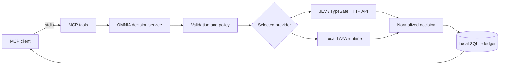

# Architecture

Both JEV and LAYA enter the same OMNIA decision service so that switching providers does not bypass validation, policy, or recording.

## Public boundary

The four tools are `omnia_evaluate`, `omnia_evaluate_batch`, `omnia_capabilities`, and `omnia_get_decision`. Evaluation arguments use a nested `request` object. Schemas are available through `omnia-mcp schemas` and `omnia://schemas`.

The supported transport is stdio. The client owns the server process. Protocol output belongs on stdout; diagnostics belong on stderr. This release has no HTTP MCP listener, multi-tenant service, OAuth server, or subscription daemon.

## Provider boundary

The TypeSafe adapter uses HTTPX and an operator-supplied API credential. It translates the common request into the provider's format and normalizes a successful response. The local adapter imports the optional, version-pinned `laya` dependency and loads the configured model revision.

Credentials and model configuration are operator settings, not tool arguments. Requests cannot select an arbitrary URL, Python module, shell command, or model download target.

LAYA's native MCP and HTTP servers are separate upstream interfaces. OMNIA MCP uses its own decision path rather than proxying their tools.

## State

SQLite holds the local decision ledger. A decision ID refers to this installation's ledger, not a globally addressable provider record. Moving or deleting the database changes what `omnia_get_decision` can retrieve. Configure persistent storage before using an ephemeral container.

The ledger persists normalized answers, evidence references, labels, score-rubric descriptions, hashes, provider identities, and usage metadata. The full input state is not stored by default; persisted records can still contain sensitive information. Expired records are removed on the first evaluation and on later evaluations that trigger an hourly maintenance check. Evaluation tools therefore advertise that they may modify and remove local data.

Cache, retention, request bounds, concurrency, and queue size are operational controls. They are not a service-capacity claim. Back up the database as application data and keep it out of Git.

## Ownership

`src/omnia_mcp` owns the MCP contract and OMNIA decision behavior. Provider libraries remain dependencies. The project does not vendor LAYA's engine or distribute model weights.

Attribution belongs in `NOTICE`. Schema and policy changes require application-contract review even when the provider API stays unchanged.
